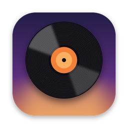
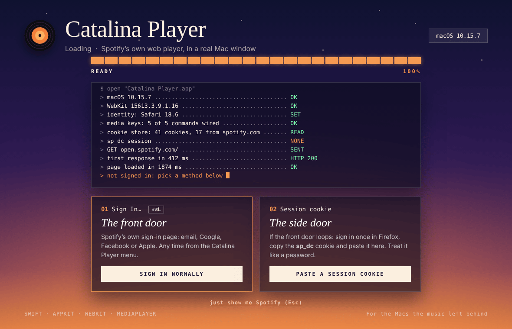
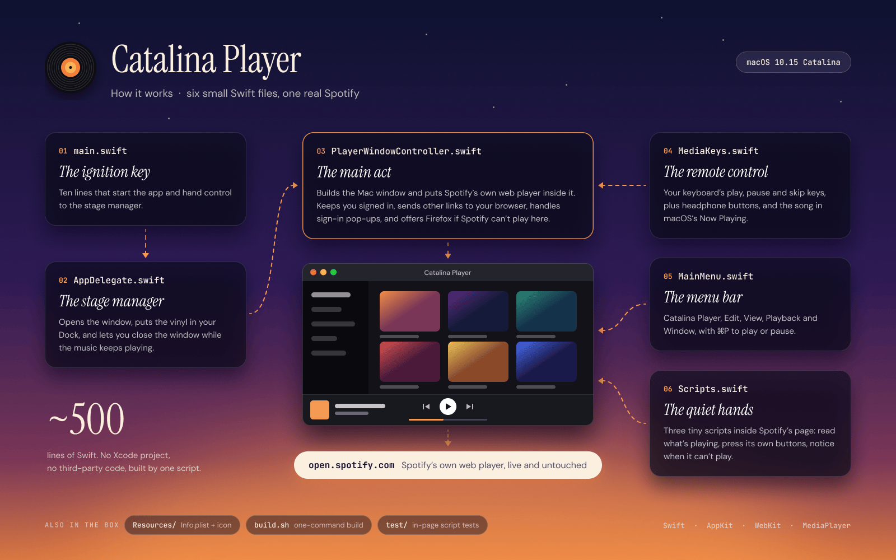

<p align="center"></p>

# 🌅 Catalina Player
### *For the Macs the music left behind*

> *One morning the installer simply said no.*
>
> *"Sorry, this version of Spotify is for macOS 11.0 or later." Nothing about the Mac had changed. It still woke instantly, still ran everything else beautifully, still sat on the desk as faithfully as ever. It had simply been declared too old to listen.*
>
> *Catalina Player is a polite refusal to accept that.*

---

> [!WARNING]
> **Status, November 2026: this doesn't play Spotify on macOS 10.15, and no app built on Catalina's own web engine can.**
> Spotify's servers send browsers older than roughly 30 months an "Unsupported browser" page. Catalina's engine is Safari 15.6, from August 2022. If the window pretends to be newer, Spotify sends its real player, but that code uses JavaScript Safari 15.6 can't even read (regex lookbehind, class static blocks), so the window stays blank. Both results were observed, not guessed: see **[AUDIT.md](AUDIT.md)**.
> The same app on a newer macOS loads the full player. **On Catalina today, use Spotify in Firefox,** which still runs on 10.15 and is current. The app offers it in one click.

## 🎧 What it is

A small, native Mac app for **macOS 10.15 Catalina** that gives the **Spotify web player** a home of its own: its own window, its own Dock icon, your keyboard's music keys, and the current song in the title bar.

It doesn't imitate Spotify, rebuild it or tinker with it. It opens **open.spotify.com**, Spotify's own web player, in a proper Mac window. Everything you see inside is the real thing, served and kept up to date by Spotify. The flip side: it can only ever be as capable as the Mac's own web engine (see the status note above).

**Unofficial.** Catalina Player is an independent project. It isn't made, endorsed, sponsored or supported by Spotify, and isn't affiliated with Spotify AB. You sign in with your own Spotify account directly on Spotify's own pages, and Spotify's Terms of Use apply as normal. The app doesn't block, skip or alter anything Spotify shows you, adverts included. It doesn't store, record, download or redistribute any music, and it doesn't touch Spotify's copy protection: playback, where it works at all, is handled by macOS's own WebKit exactly as in Safari. "Spotify" is used only to say what the app opens; the name and icon are its own.

## ✨ What you get

- **A real Mac app.** Dock icon, ⌘Q, ⌘H, full screen, and window size and position remembered between launches.
- **Your keyboard's ⏯ ⏭ ⏮ keys** (and AirPods/headphone buttons) control the music, even when the window is hidden.
- **Now playing** in the title bar and in macOS's Now Playing controls.
- **Close the window, keep the music.** ⌘W hides it; click the Dock icon to bring it back.
- **Stays signed in** between launches.
- **Zoom** with ⌘+ / ⌘− / ⌘0, remembered.
- **Links that aren't Spotify** (help pages, artist sites) open in your normal browser.
- **Playback shortcuts:** ⌘P play/pause, ⌃⌘→ next, ⌃⌘← previous.
- **A safety net.** If Spotify says it can't play in this window, the app tells you and offers to open the same page in **Firefox**, which still supports Catalina, in one click.

## 📟 The welcome screen

Every launch opens on a welcome screen in the same dusk style as the diagram above. Beneath it runs a see-through log of what the app is actually doing: your macOS and WebKit versions, the media keys being wired, what's in the cookie store, and the real request and load times for Spotify's page. If you're signed in it gets out of the way by itself. If you're not, the two ways in appear at the top as soon as it knows: **01, the front door**: Spotify's normal sign-in (⇧⌘L any time). **02, the side door**: the session cookie from Firefox. Bring it back from *Catalina Player → Show Loading Screen*.

<p align="center"></p>

## 🛠️ Build it on your Mac (2 minutes)

**1. Get Apple's free build tools** (once; skip if you have Xcode):
```bash
xcode-select --install
```

**2. Get the code and build:**
```bash
git clone https://github.com/lolo737/catalina-player.git
cd catalina-player
./build.sh
```

**3. Try it, then install it:**
```bash
open "build/Catalina Player.app"
cp -R "build/Catalina Player.app" /Applications/
```

Because you built it yourself, macOS opens it without the "unidentified developer" warning.

### Or download a ready-made build
Run **Actions → Build app → Run workflow** on GitHub (or push a tag such as `v1.0.0`) and a universal `Catalina-Player.zip` appears, for Intel Macs on 10.15+ and Apple silicon on 11+. Downloaded builds are unsigned, so the first time, **right-click the app → Open → Open**.

## 🧪 What to expect on each Mac

| Mac | What happens | Why |
|---|---|---|
| macOS 10.15 Catalina | ⚠️ *"Unsupported browser"*, then the app offers **Open in Firefox** | Catalina's engine (Safari 15.6) is older than Spotify's cut-off. Observed: [AUDIT.md](AUDIT.md) |
| macOS 11 Big Sur | Probably the same (its last Safari is 16.6; not tested) | Also outside the window, likely |
| macOS 12 and later | ✅ The full player loads | Observed on GitHub's macOS 15 machine. Copy protection: FairPlay is granted to the window |

The precise test steps, and what to send back from a Catalina Mac, are in [AUDIT.md § Owner test](AUDIT.md#owner-test-on-a-real-catalina-mac).

## 🔍 How it works

<p align="center"></p>

- **Swift + AppKit + WebKit**, about 500 lines, no third-party code. Built for Catalina's own Swift toolchain, so no Xcode project or modern SDK is needed.
- The window tells Spotify the truth: this Mac's real Safari version. (An earlier version pretended to be a current Safari. That got past the "Unsupported browser" page but led to a blank window, and pretending sits badly with Spotify's rules, so it's now an opt-in experiment only: `defaults write io.github.lolo737.catalinaplayer UserAgent modern`.)
- A small **compatibility shim** adds a few JavaScript functions old engines lack (`Object.groupBy`, `Array.prototype.toSorted`, the new `Set` methods and so on), only where they're missing. It can't add missing *syntax*, which is what stops Spotify's player on Catalina. Turn it off with `defaults write io.github.lolo737.catalinaplayer DisableCompatShims -bool true`.
- The media keys go through **MPRemoteCommandCenter** and press Spotify's own on-screen buttons. The now-playing text is read from the player bar. Neither changes anything on the page.
- Logins with Google, Facebook or Apple open in a small sign-in window, as they would in Safari.
- **Signing in:** *Sign In…* (⇧⌘L) opens Spotify's normal sign-in page. *Sign In with a Session Cookie…* lets you carry over a sign-in from Firefox by pasting its `sp_dc` cookie. That cookie *is* your logged-in account: paste it only into the app, never into a chat, issue or email. If it ever leaks, use *Sign out everywhere* in your Spotify account settings. On Catalina neither route helps, because the player itself can't run there. *Sign Out and Clear Data* starts afresh.
- Right-click → **Inspect Element** opens Safari's Web Inspector, for reading page errors.
- **Debug console:** *View → Debug Console* (⌥⌘C) shows that log live, plus Spotify's own console messages, and has a command line that runs JavaScript in the Spotify page. Tick *View → Open Console at Launch* to have it there from the first second.
- **Something not working?** *Catalina Player → Show Diagnostics Log* reveals `~/Library/Logs/CatalinaPlayer.log`: page loads and redirects, HTTP status, JavaScript errors, which modern browser features this Mac's engine lacks (split into syntax, functions and CSS), which copy-protection systems the engine will grant, whether the page actually drew anything, and each sign-in step. It never records cookie values, passwords or query-string values, so it's safe to attach to an issue.

```
Sources/
├── main.swift                    starts the app
├── AppDelegate.swift             launch, Dock icon, keep playing when closed
├── PlayerWindowController.swift  the window, web view, links, sign-in pop-ups
├── MediaKeys.swift               ⏯ ⏭ ⏮ keys and Now Playing
├── MainMenu.swift                the menu bar
├── Scripts.swift                 the small JavaScript that reads and presses the player bar
├── Compat.swift                  polyfills for functions old engines lack
├── Diagnostics.swift             the log: loads, errors, missing features, DRM, render check
├── DebugConsole.swift            the live console window
├── SelfTest.swift                unattended run for CI and for testing on a real Mac
└── Splash.swift, Fonts.swift     the welcome screen
Resources/                        Info.plist and the icon
build.sh                          one-command build
test/                             tests for the in-page scripts, the shim and the probes
scripts/scan-spotify-bundle.mjs   checks Spotify's public player code against Safari 15.6
```

## 🧪 Tests

```bash
npm install && npm test
```

The in-page scripts are tested against a mock Spotify player bar: reading the title, artist and play state, pressing play/pause/next/previous (and *not* pressing play when it's already playing), falling back to the page title, and spotting Spotify's "can't play here" message exactly once. The shim is tested against the native functions with the natives deleted, and the probes and redaction are tested too. The **Self-test** workflow compiles the app on GitHub's Mac, runs it unattended (honest, disguised, hostile-message and offline runs), and scans Spotify's public player code for syntax Safari 15.6 can't parse.

## 🙏 Credits & licence

Icon and code by Niall O'Hara, MIT licensed (see [LICENSE](LICENSE)). The welcome screen uses Instrument Serif, DM Sans and JetBrains Mono, embedded under the SIL Open Font License (see [Resources/FONT-LICENSES.txt](Resources/FONT-LICENSES.txt)). Spotify is a trademark of Spotify AB; this project isn't affiliated with Spotify.

*Built in Skerries, for a Mac that still had plenty of music left in it.*
