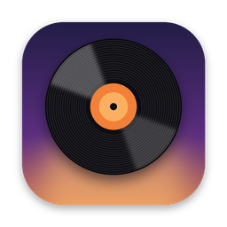
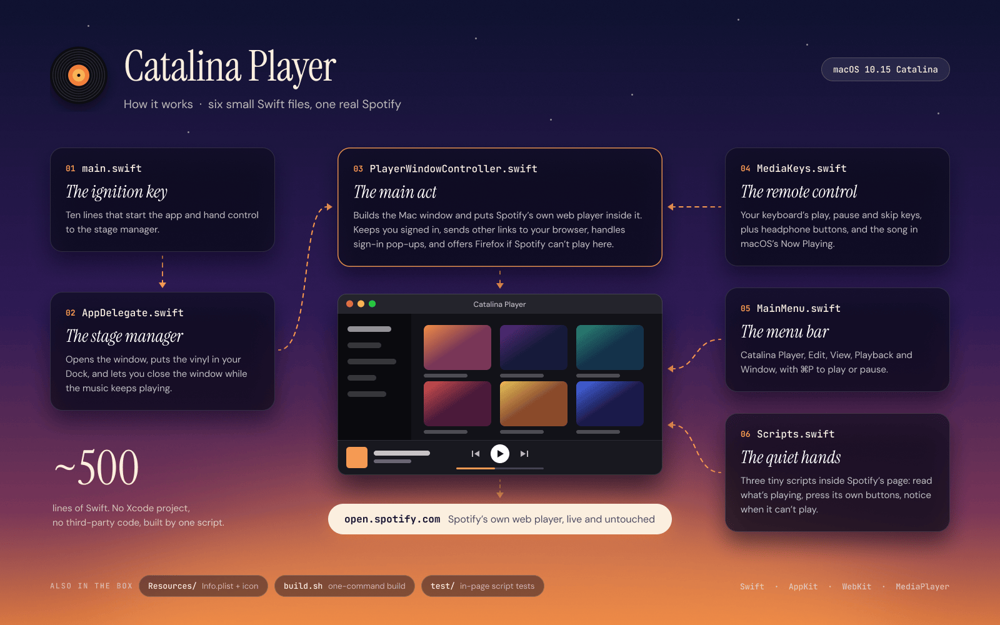

<p align="center"></p>

# 🌅 Catalina Player
### *For the Macs the music left behind*

> *One morning the installer simply said no.*
>
> *"Sorry, this version of Spotify is for macOS 11.0 or later." Nothing about the Mac had changed. It still woke instantly, still ran everything else beautifully, still sat on the desk as faithfully as ever. It had simply been declared too old to listen.*
>
> *Catalina Player is a polite refusal to accept that.*

---

## 🎧 What it is

A small, native Mac app for **macOS 10.15 Catalina** that gives the **Spotify web player** a home of its own: its own window, its own Dock icon, your keyboard's music keys, and the current song in the title bar.

It doesn't imitate Spotify, rebuild it or tinker with it. It opens **open.spotify.com**, Spotify's own web player, in a proper Mac window. Everything you see inside is the real thing, served and kept up to date by Spotify. That's why it lasts: there's nothing to re-patch when Spotify updates, because nothing was patched to begin with.

**Unofficial.** Catalina Player isn't made, endorsed or supported by Spotify. You sign in with your own Spotify account, and Spotify's terms apply as normal. It doesn't block, skip or alter anything Spotify shows you, adverts included.

## ✨ What you get

- **A real Mac app.** Dock icon, ⌘Q, ⌘H, full screen, and window size and position remembered between launches.
- **Your keyboard's ⏯ ⏭ ⏮ keys** (and AirPods/headphone buttons) control the music, even when the window is hidden.
- **Now playing** in the title bar and in macOS's Now Playing controls.
- **Close the window, keep the music.** ⌘W hides it; click the Dock icon to bring it back.
- **Stays signed in** between launches.
- **Zoom** with ⌘+ / ⌘− / ⌘0, remembered.
- **Links that aren't Spotify** (help pages, artist sites) open in your normal browser.
- **Playback shortcuts:** ⌘P play/pause, ⌃⌘→ next, ⌃⌘← previous.
- **A safety net.** If Spotify says it can't play in this window, the app tells you and offers to open the same page in **Firefox**, which still supports Catalina, in one click.

## 🛠️ Build it on your Mac (2 minutes)

**1. Get Apple's free build tools** (once; skip if you have Xcode):
```bash
xcode-select --install
```

**2. Get the code and build:**
```bash
git clone https://github.com/lolo737/catalina-player.git
cd catalina-player
./build.sh
```

**3. Try it, then install it:**
```bash
open "build/Catalina Player.app"
cp -R "build/Catalina Player.app" /Applications/
```

Because you built it yourself, macOS opens it without the "unidentified developer" warning.

### Or download a ready-made build
Run **Actions → Build app → Run workflow** on GitHub (or push a tag such as `v1.0.0`) and a universal `Catalina-Player.zip` appears, for Intel Macs on 10.15+ and Apple silicon on 11+. Downloaded builds are unsigned, so the first time, **right-click the app → Open → Open**.

## 🧪 The first-run test that matters

Spotify protects its music with copy protection, and whether a home-made app window on Catalina is allowed to play it can only be proven on a real Catalina Mac. So the first thing to do:

1. Open Catalina Player and sign in.
2. Play any song.

| What happens | What it means |
|---|---|
| 🎵 Music plays | You're done. Enjoy it. |
| ⚠️ *"Spotify won't play in this window"* | This Mac's web engine can't do Spotify's copy protection. Click **Open in Firefox**, and you get the same Spotify, in Firefox, on Catalina. |

Either way you end up with Spotify on your Catalina Mac. If you hit the second case, please open an issue with your macOS version, so the README can say for certain.

## 🔍 How it works

<p align="center"></p>

- **Swift + AppKit + WebKit**, about 500 lines, no third-party code. Built for Catalina's own Swift toolchain, so no Xcode project or modern SDK is needed.
- Spotify only welcomes browsers updated in roughly the last 30 months, and judges that by the version number the browser announces. Catalina's last Safari (15.6) is older than that, so the window announces itself as a **current Safari**. Every modern Safari still reports "Mac OS X 10_15_7", so it blends in. The engine underneath is still Catalina's own WebKit.
- If Spotify ever moves the goalposts, you can change that announcement without rebuilding:
  ```bash
  defaults write io.github.lolo737.catalinaplayer UserAgent "Mozilla/5.0 (Macintosh; Intel Mac OS X 10_15_7) AppleWebKit/605.1.15 (KHTML, like Gecko) Version/19.0 Safari/605.1.15"
  ```
  (`defaults delete io.github.lolo737.catalinaplayer UserAgent` puts it back.)
- The media keys go through **MPRemoteCommandCenter** and press Spotify's own on-screen buttons. The now-playing text is read from the player bar. Neither changes anything on the page.
- Logins with Google, Facebook or Apple open in a small sign-in window, as they would in Safari.
- **Stuck signing in?** Spotify's sign-in pages are newer than Catalina's web engine and can loop. The dependable route: *Catalina Player → Sign In with a Session Cookie…* lets you sign in once in Firefox and paste your `sp_dc` cookie across. It's your own sign-in, so treat it like a password. *Clear Sign-in Data* starts afresh.
- Right-click → **Inspect Element** opens Safari's Web Inspector, for reading page errors.

```
Sources/
├── main.swift                    starts the app
├── AppDelegate.swift             launch, Dock icon, keep playing when closed
├── PlayerWindowController.swift  the window, web view, links, sign-in pop-ups
├── MediaKeys.swift               ⏯ ⏭ ⏮ keys and Now Playing
├── MainMenu.swift                the menu bar
└── Scripts.swift                 the small JavaScript that reads and presses the player bar
Resources/                        Info.plist and the icon
build.sh                          one-command build
test/                             tests for the in-page scripts
```

## 🧪 Tests

```bash
npm install && npm test
```

The in-page scripts are tested against a mock Spotify player bar: reading the title, artist and play state, pressing play/pause/next/previous (and *not* pressing play when it's already playing), falling back to the page title, and spotting Spotify's "can't play here" message exactly once. The Swift itself is checked by the compiler on your Mac when you run `./build.sh`.

## 🙏 Credits & licence

Icon and code by Niall O'Hara, MIT licensed (see [LICENSE](LICENSE)). Spotify is a trademark of Spotify AB; this project isn't affiliated with Spotify.

*Built in Skerries, for a Mac that still had plenty of music left in it.*
